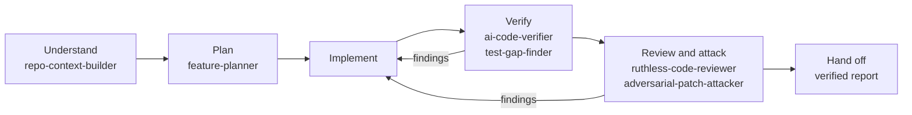

# SkillMaster

Agent skills that make AI coding reliable from the first prompt to the final tested change.

Each skill is a folder with a `SKILL.md` in the open [Agent Skills](https://agentskills.io/specification)
format, so it works in Claude Code, Codex, GitHub Copilot, and other agents that read that format.
Every skill ends with an explicit result such as `FIXED`, `GAPS FOUND`, or `BLOCK`, and separates
checks that actually ran from assumptions that were never verified.

## Skills

| Stage | Skill | Use it when | Ends with |
|-------|-------|-------------|-----------|
| Understand | [repo-context-builder](skills/repo-context-builder/SKILL.md) | You open an unfamiliar repo, or want a draft `AGENTS.md` | A context document; every command labeled `verified`, `documented`, or `inferred` |
| Plan | [feature-planner](skills/feature-planner/SKILL.md) | A request needs requirements, acceptance criteria, and steps before coding | `READY`, `READY WITH ASSUMPTIONS`, `BLOCKED` |
| Diagnose | [bug-reproducer](skills/bug-reproducer/SKILL.md) | A bug report, crash, or regression needs reproducing, diagnosing, or fixing | `FIXED`, `REPRODUCED`, `NOT REPRODUCED`, `INCONCLUSIVE` |
| Diagnose | [ci-failure-investigator](skills/ci-failure-investigator/SKILL.md) | A GitHub Actions run or PR check is red or flaky | `CODE DEFECT`, `TEST DEFECT`, `FLAKY`, `ENVIRONMENT`, `CONFIGURATION`, `INCONCLUSIVE` |
| Change | [safe-refactor](skills/safe-refactor/SKILL.md) | Code must be restructured without changing behavior | `BEHAVIOR PRESERVED`, `PRESERVED WITH GAPS`, `ABORTED` |
| Verify | [ai-code-verifier](skills/ai-code-verifier/SKILL.md) | AI-written code or an AI's "tests pass" claim needs checking | `VERIFIED`, `ISSUES FOUND`, `FAILED`, `INCONCLUSIVE` |
| Verify | [ci-parity-check](skills/ci-parity-check/SKILL.md) | Local checks pass but CI runs on another OS, runtime version, or clean checkout, or a test may be flaky | `PARITY`, `DIVERGES`, `FLAKY`, `PARTIAL` |
| Verify | [test-gap-finder](skills/test-gap-finder/SKILL.md) | You need to know which behaviors are untested, and want tests proven to fail on breakage | `ADEQUATE`, `GAPS CLOSED`, `GAPS FOUND`, `DEFECT FOUND`, `INCONCLUSIVE` |
| Review | [ruthless-code-reviewer](skills/ruthless-code-reviewer/SKILL.md) | A diff, commit, or PR needs a defect-first review | `APPROVE` … `BLOCK`, `INCONCLUSIVE` |
| Review | [adversarial-patch-attacker](skills/adversarial-patch-attacker/SKILL.md) | You explicitly want a patch attacked with reproduction tests | `SURVIVED`, `BROKEN`, `SUSPICIOUS`, `NO REACHABLE SURFACE`, `INCONCLUSIVE` |
| Ship | [release-captain](skills/release-captain/SKILL.md) | A version needs preparing, or tagging and publishing all the way to the registry | `READY TO TAG`, `RELEASED`, `PUBLISHED, AWAITING REGISTRY`, `BLOCKED`, `NOT READY` |
| Hand off | [session-handoff](skills/session-handoff/SKILL.md) | You switch chats, models, tools, or people mid-task | A 40–80 line handoff note built from git and real check results |
| Hand off | [context-keeper](skills/context-keeper/SKILL.md) | You move one task between chats and tools, such as Claude Code, Codex, or a local Ollama model, and each should start where the last stopped | A record per conversation in a local `.context/` folder, a brief to resume from, and hooks that save and resume by themselves |
| All stages | [skillmaster-workflow](skills/skillmaster-workflow/SKILL.md) | You want a change taken end to end: understand, plan, implement, verify, review | `VERIFIED`, `PARTIALLY VERIFIED`, `ISSUES REMAIN`, `BLOCKED` |
| Build | [figma-implementer](skills/figma-implementer/SKILL.md) | A Figma design needs building and checking in the running app; a Figma tab and a localhost tab are all it needs | `MATCHES`, `MATCHES WITH DEVIATIONS`, `MISMATCHES`, `BLOCKED` |
| Browser | [chrome-browser](skills/chrome-browser/SKILL.md) | You need to inspect or interact with a page in your running Chrome | Observations and the actions completed |
| Browser | [action-tracker](skills/action-tracker/SKILL.md) | You want a visible overlay that logs every click and keystroke on a page, or a Playwright test of what you clicked through | Overlay installed, the log or test handed over; removed when the work is done |

## The workflow

`skillmaster-workflow` chains the skills, with a gate between each stage:



Bugs start at `bug-reproducer`, CI failures at `ci-failure-investigator`, refactors at
`safe-refactor`, screens from a Figma design at `figma-implementer`, and releases at
`release-captain`, which runs `ci-parity-check` before the tag. Work that moves between chats or
tools keeps its state in `context-keeper`'s records. A change to a page is also checked
in the running app, and one headed for CI on another platform is run there first. The final report
lists the checks that ran on the final code, the assumptions that remain unverified, and the
residual risks. See [examples/](examples/) for complete walkthroughs.

## Install

Install the whole folder for each skill: skills carry their own `references/` and `scripts/`.
`skillmaster-workflow` hands each stage to the matching skill, so install every skill for the best
results.

### Claude Code

Install all skills as a plugin:

```text
/plugin marketplace add mkhitar-abrahamyan/SkillMaster
/plugin install skillmaster@skillmaster
```

Plugin skills are namespaced, for example `skillmaster:bug-reproducer`. To install single skills
instead, use the GitHub CLI or copy folders into `~/.claude/skills/` (personal) or
`.claude/skills/` (project).

### GitHub CLI (Claude Code, Codex, Copilot, Cursor, Gemini CLI, and more)

[`gh skill`](https://cli.github.com/manual/gh_skill_install) requires GitHub CLI 2.90.0 or later
and is in public preview.

```bash
# Pick skills interactively
gh skill install mkhitar-abrahamyan/SkillMaster

# One skill, for one agent, for every project
gh skill install mkhitar-abrahamyan/SkillMaster bug-reproducer --agent claude-code --scope user

# Every skill into the current project for Codex (Copilot: --agent github-copilot)
gh skill install mkhitar-abrahamyan/SkillMaster --all --agent codex
```

`gh skill` installs the latest tagged release, falling back to the default branch. Pin a version
with `skill@<tag>` or `--pin <tag>`. GitHub does not verify skills; read a skill before you install
it, this one included.

### Manual copy

| Agent | Project skills | Personal skills |
|-------|----------------|-----------------|
| Claude Code | `.claude/skills/` | `~/.claude/skills/` |
| Codex | `.agents/skills/` (scanned from the working directory up to the repo root) | `~/.agents/skills/` |
| GitHub Copilot | `.github/skills/`, `.claude/skills/`, or `.agents/skills/` | `~/.copilot/skills/` |

```bash
git clone https://github.com/mkhitar-abrahamyan/SkillMaster.git
mkdir -p ~/.claude/skills
cp -r SkillMaster/skills/bug-reproducer ~/.claude/skills/
```

```powershell
git clone https://github.com/mkhitar-abrahamyan/SkillMaster.git
New-Item -ItemType Directory -Force "$HOME\.claude\skills" | Out-Null
Copy-Item -Recurse SkillMaster\skills\bug-reproducer "$HOME\.claude\skills\"
```

## Prerequisites

| Skills | Needs |
|--------|-------|
| All | `git`, and the project's own toolchain for running its tests |
| `ci-failure-investigator` | GitHub CLI (`gh`) authenticated for the repository, or a pasted log |
| `ci-parity-check` | What stands in for CI here: WSL or a Linux VM, Docker or Podman, side-by-side runtime versions |
| `release-captain` | The project's release pipeline; `gh` to watch it, and the registry's CLI, such as `npm` |
| `figma-implementer` | A Figma MCP server, the Chrome DevTools MCP server as for `chrome-browser`, and Node.js for its scripts |
| `context-keeper` | Node.js 18 or later and git; Claude Code or Codex to save and resume by themselves |
| `chrome-browser`, `action-tracker` | The [Chrome DevTools MCP server](https://github.com/ChromeDevTools/chrome-devtools-mcp) configured as `chrome-devtools`, and Chrome with remote debugging enabled |
| Contributing | Python 3.9+ with PyYAML, and Node.js |

## Example prompts

| Prompt | What you get |
|--------|--------------|
| "I just cloned this repo. How is it organized and how do I run one test?" | A context document with traced entry points and provenance-labeled commands |
| "Plan CSV export for invoices before writing any code." | Acceptance criteria, impacted files, steps with `verify:` lines, and `Plan readiness: READY…` |
| "Dates show as yesterday for users in UTC-5. Reproduce and fix it." | A failing test, the root cause at `file:line`, the fix, red-to-green evidence, `Bug status: FIXED` |
| "Why is this run red? https://github.com/org/repo/actions/runs/123" | The first meaningful failure, a comparison with the last green run, and a classification |
| "Cursor wrote this module and says the tests pass. Verify it." | A claims table (`verified` / `contradicted` / `unverified`) and checks for invented packages and APIs |
| "Is my discount change adequately tested? Add what's missing." | A behavior map, plus new tests each proven to fail when its behavior breaks |
| "Split this 900-line controller without changing behavior." | Baseline and after-refactor comparison, step-by-step check results |
| "Review my uncommitted changes." | P0–P3 findings with confidence labels and a verdict |
| "Try to break my rate limiter with concurrent requests." | Executed attack tests and `Attack result: BROKEN`, `SURVIVED`, … |
| "Tests pass on my Windows machine. Will they pass on the Linux CI before I tag?" | Each CI cell run locally from a clean export, flakes measured, and `CI parity: PARITY` or the first divergence |
| "Make my localhost tab match the Figma tab I have open." | A ledger of every design detail, the build with the project's components and tokens, measurements and a pixel comparison per state and breakpoint, `Design match: MATCHES` or the deviations |
| "Release 2.4.0 and make sure npm actually gets it." | Versions everywhere, dated notes, the gate where the publish runs, the tag, the publish watched to the registry, `Release status: RELEASED` |
| "Save where we are so I can continue in Codex, and make it happen by itself from now on." | This conversation's record in `.context/`, hooks for Claude Code and Codex, and a brief the next session starts from |
| "I'm switching to a new chat. Write a handoff." | A handoff note with fresh/stale check status and an immediately executable next step |
| "Use SkillMaster to add Google sign-in to my NestJS API, test it, and review it for security problems." | All stages run, ending in a `Delivery result:` report |

## Safety and privacy

- Review and verification skills leave the reviewed source unchanged. Generated tests, mutation
  checks, and reproduction scripts go to scratch space or an isolated copy unless you ask for them
  to be added to the project.
- No skill commits, pushes, re-runs CI, deploys, runs migrations against shared databases, or
  changes secrets without your explicit approval.
- No skill reads `.env` files, secrets, credentials, or dumps; configuration shape comes from
  example files. The one exception asks first: without the GitHub CLI, `ci-failure-investigator`
  can read Actions logs with a token you already have configured, such as git's credential helper,
  only with your go-ahead, and never prints or stores it.
- Browser skills act in your real Chrome session through the DevTools protocol, so the agent can see
  what the page shows and act as you. They stay within the requested scope, do not read cookies or
  stored credentials, and remove their overlays when done. Enable remote debugging only while you
  need it, ideally in a profile without unrelated signed-in sessions.
- The tracker overlays are click-through except their panel's grip and buttons, which move it, fold
  it, and copy its log or a Playwright test of its steps; the panel moves off an element before the
  agent acts on it. Between the actions they log failed requests and page errors, and they keep
  the recording in the tab's session storage, so it continues after a reload once the script runs
  again. `.off()` drops it.
- `context-keeper`'s `.context/` folder stays on your machine: it is created with a `.gitignore`
  of its own, a record that holds a secret is not saved, and the hooks it wires live in each tool's
  local settings, kept out of git. A record is treated as notes to check, not as instructions.
- Both tracker overlays mask what is typed into sensitive fields, because the overlay appears in
  screenshots: passwords, payment fields, one-time codes, API keys and tokens, PINs, and bank and
  government IDs show as `•••` whatever their length, and their keystrokes are not logged. A field
  stays masked after a "show password" toggle, and `data-tracker-mask` masks any other field. An
  exported test fills a masked field from an environment variable; tokens in URLs and errors are
  masked too. The policy is [scripts/blocks/sensitive-field.js](scripts/blocks/sensitive-field.js),
  embedded in both overlays, and `tools/test_trackers.mjs` and `tools/test_recording.mjs` prove it
  in headless Chrome on every push.

## Repository layout

```text
skills/<name>/SKILL.md      one folder per skill; name matches the folder
skills/<name>/references/   reference files the skill links to (copies of shared files are synced)
skills/<name>/scripts/      scripts the skill runs (copies of shared scripts are synced)
references/                 canonical shared references: repository rules, stack checks, registries
scripts/                    canonical shared scripts, such as the mutation runner `mutate.mjs`
scripts/blocks/             code embedded in self-contained scripts, such as the trackers' masking policy
evals/<name>.json           trigger evals: prompts that should and should not activate each skill
examples/                   end-to-end walkthroughs
tools/validate_skills.py    the CI validator
tools/test_*.mjs            tests of the bundled scripts: the trackers' masking and recording, context-keeper's records and hooks, the mutation runner, and figma-implementer's measuring and pixel comparison
.claude-plugin/             Claude Code plugin and marketplace manifests
```

## Contributing

1. Keep every file a skill needs inside its folder; installs copy only that folder. Edit shared
   references in `references/`, shared scripts in `scripts/`, and embedded blocks in
   `scripts/blocks/`, then run `python tools/validate_skills.py --fix` to sync the copies.
2. Add `evals/<skill>.json` with at least three prompts that should trigger the skill and three
   near-misses that should not.
3. Run `python tools/validate_skills.py` and each `node tools/test_*.mjs`. CI runs the same on every push and pull request: frontmatter against
   the spec, links and bundled paths, drift of shared references, scripts, and blocks, JavaScript
   syntax, eval coverage and prompts claimed by two skills, plugin manifests, and the shared scripts'
   own tests.

To measure how reliably a description triggers, run the eval set with the
[skill-creator](https://github.com/anthropics/skills) plugin's `run_eval.py`, from that skill's
directory. It calls `claude -p` several times per prompt and uses your Claude usage.

```bash
python -m scripts.run_eval --eval-set /path/to/SkillMaster/evals/bug-reproducer.json \
  --skill-path /path/to/SkillMaster/skills/bug-reproducer
```

## Roadmap

| Release | Scope | Status |
|---------|-------|--------|
| v0.1 | Standard packaging, README, LICENSE, install guide, CI validation | Done |
| v0.2 | repo-context-builder, feature-planner, bug-reproducer | Done |
| v0.3 | ai-code-verifier, test-gap-finder, safe-refactor, ci-failure-investigator, session-handoff | Done |
| v0.4 | skillmaster-workflow and end-to-end examples | Done |
| v0.5 | Tracker masking proven in Chrome, tracker recordings as Playwright tests, a shared mutation runner, sharper skills, ci-parity-check, release-captain, figma-implementer | Done |
| v0.6 | context-keeper: a record per conversation in `.context/`, resumed in any chat or tool, saved and resumed by Claude Code and Codex hooks | Ready, not released |
| v1.0 | One-command install (Claude Code plugin and `gh skill`), trigger-eval runs, behavioral evaluations, tested compatibility across assistants | Install done; eval runs and cross-assistant testing open |

Planned specialized skills: React and Next.js performance, accessibility, NestJS API contracts, and
database migration safety.

## License

[MIT](LICENSE)
